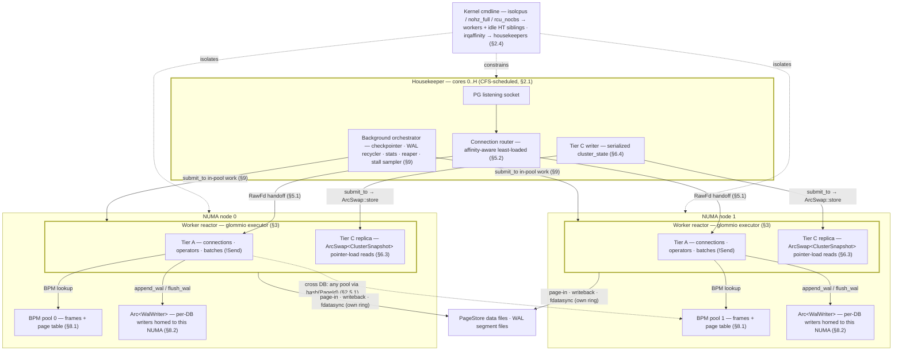
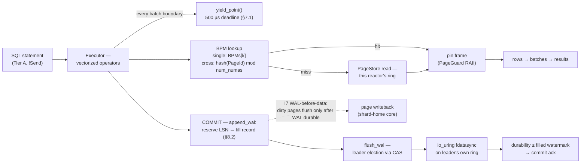
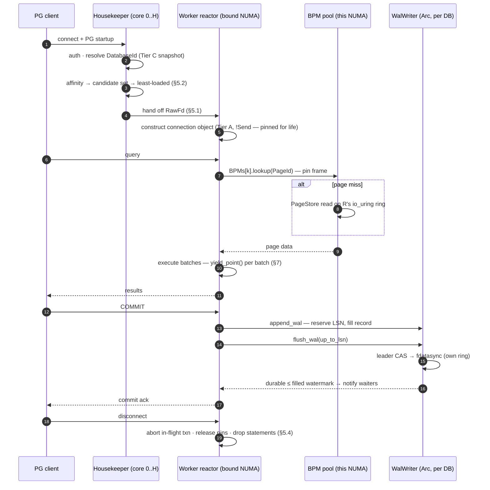
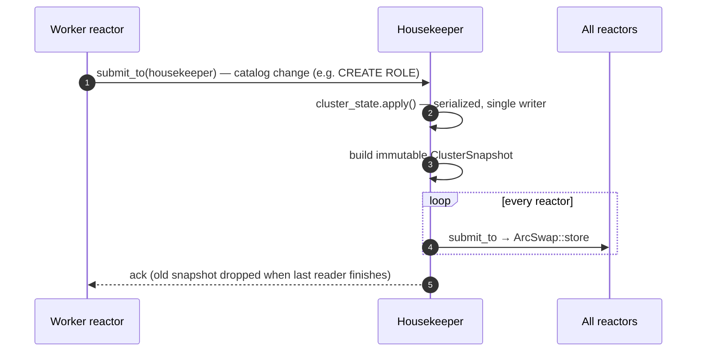

# Cascade DB — Runtime Architecture Diagrams

Visual companion to [runtime-architecture.md](runtime-architecture.md); the spec remains
authoritative. Section references (§) point into the spec.

Each figure has two representations that must be kept in sync:

- **Mermaid source** below — the editable original; renders natively on GitHub and in
  Mermaid-enabled Markdown previews.
- **Rendered figure** in [assets/](assets/) (PNG + SVG) — hand-laid-out for viewers
  without Mermaid support. When a diagram changes, update both.

## A. Runtime components & topology (§2–§4)

Rendered: [PNG](assets/runtime-components.png) · [SVG](assets/runtime-components.svg)

## B. OLTP hot-path data flow (§7–§8)

Rendered: [PNG](assets/runtime-hotpath.png) · [SVG](assets/runtime-hotpath.svg)

## C. Workflow — connection lifecycle, query, commit (§5, §7, §8.2)

Rendered: [PNG](assets/runtime-seq-connection.png) · [SVG](assets/runtime-seq-connection.svg)

## D. Workflow — Tier C catalog write (§6.4, §8.4)

Rendered: [PNG](assets/runtime-seq-tierc.png) · [SVG](assets/runtime-seq-tierc.svg)

## Notes

- **Border weight encodes what is a thread** (Figure A): a **thick** border marks the only
  real threads — the housekeeper band (H threads, one per core) and each worker-reactor box
  (one pinned thread; the box stands for ×W reactors per NUMA). Thin-bordered boxes —
  Tier A, Tier C replica, BPM pools, WAL writers, files — are memory or data owned or shared
  by those threads, not threads themselves. The Mermaid source mirrors this with
  `style … stroke-width:3px` on the same three subgraphs.
- `Arc<WalWriter>` and `ArcSwap<ClusterSnapshot>` are HTML-escaped (`&lt;`/`&gt;`) inside
  Mermaid **flowchart** labels because Mermaid strips unknown HTML tags; the sequence
  diagrams sidestep this with participant aliases (`WalWriter (Arc, per DB)`).
- Figures A and C show one NUMA node pair and one representative `cross`-affinity edge
  (`TA0 -.-> BPM1`); the node-1 mirror images are omitted for readability. The
  `single`-affinity routing-refusal path (§5.2) is prose-only.
- Boot/shutdown (§10) and eviction/checkpoint internals (§8.1, §9) are deliberately not
  diagrammed — they are orchestration detail best read in the spec text.
